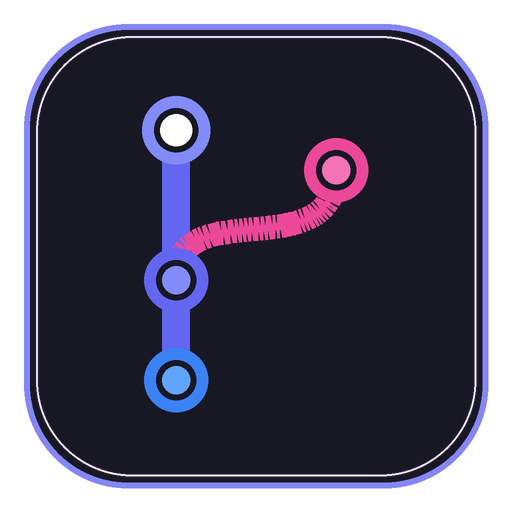
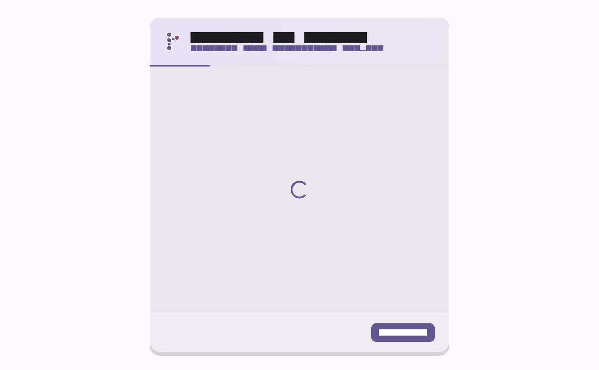

# Gitora

<div align="center">
  
  <h3>Powerful Git. Beautifully Simple.</h3>
  <p>Полноценный, современный, красивый и производительный кроссплатформенный Git-клиент на Flutter с Material 3 Expressive.</p>

  [](https://github.com/SkrinVex/Gitora/actions)
  [](LICENSE)
  [](#)
</div>

---

## 📸 Скриншоты интерфейса / Screenshots

<p align="center">
  
</p>

---

## 🌟 О проекте

**Gitora** — это не демо и не статичный концепт. Это полноценный рабочий Git-клиент, созданный для ежедневной работы разработчиков. Он сочетает высокую скорость нативного движка `libgit2` (`git2dart`), универсальность системного `git CLI`, эргономику **Material Design 3 Expressive** и реактивное состояние на **Riverpod 3**.

### Ключевые преимущества:
- 🚀 **Двухъядерный Git Backend (Hybrid Engine):**
  - **libgit2 (`git2dart`):** Мгновенное чтение статуса, дерева объектов, коммитов и веток без накладных расходов на порождение процессов.
  - **Git CLI Backend:** Безопасный запуск системного Git с раздельной передачей аргументов (без shell injection) для сложных операций (интерактивный hunk staging, pull/push/fetch по HTTPS/SSH, submodules).
  - Автоматический fallback и переключение режимов в настройках.
- 🎨 **Material 3 Expressive UI:**
  - Динамическая генерация палитр `ColorScheme.fromSeed` (выбор фирменного цвета: фиолетовый, синий, индиго, изумрудный, оранжевый, розовый).
  - Полная поддержка светлой, тёмной и системной темы.
  - Адаптивные скругления, микро-анимации, skeleton loading, тултипы и hover/active состояния.
- 🌳 **Интерактивный Git Graph (CustomPainter):**
  - Визуализация линий ветвления и merge-коммитов по топологическому порядку.
  - Цветовая дифференциация дорожек (lanes).
  - Значки веток, тегов и указателя `HEAD`.
  - Поиск по автору, хешу и тексту сообщения.
- 🔍 **Продвинутый Diff Viewer:**
  - Режимы отображения: **Unified Diff** и **Side-by-Side (Split) Diff**.
  - Номера строк (old/new), подсветка добавленных (`#2E7D32`) и удалённых (`#C62828`) строк.
  - Интерактивный stage/unstage отдельных фрагментов (hunks).
  - Поддержка Unicode, UTF-8, кириллицы и детекция бинарных файлов.
- ⚡ **Command Palette (Ctrl+K):**
  - Быстрый доступ ко всем операциям с клавиатуры с fuzzy-поиском.
- 🛡️ **Безопасность данных:**
  - Явные модальные подтверждения (`ConfirmDialog`) для всех потенциально разрушительных операций (discard изменений, hard reset, force push, drop stash, удаление веток).
- 🌍 **Локализация (Flutter l10n):**
  - Нативная поддержка Русского и Английского языков (ARB).

---

## 🏗️ Архитектура

Проект построен по принципам Clean Architecture с четким разделением слоев:

```
lib/
├── application/         # Слой приложения: Riverpod Notifiers & State Providers
│   ├── providers/       # settings, repos, diff, history, tasks, onboarding
├── core/                # Константы, палитры, тема, утилиты
│   ├── constants/
│   ├── theme/
│   └── utils/
├── domain/              # Доменные сущности и абстракции
│   ├── models/          # GitCommit, GitDiff, GitBranch, GitRemote, GitStash, GitStatus
│   └── services/        # GitService интерфейс
├── infrastructure/      # Реализация адаптеров и внешних сервисов
│   ├── db/              # SQLite FFI (хранение избранных и недавних репозиториев)
│   ├── git/             # LibGit2Service, GitCliService, HybridGitService
│   └── watcher/         # Live FileSystemWatcher с debounce 350мс
├── presentation/        # UI-слой (Material 3 Expressive)
│   ├── screens/         # Dashboard, Changes, History, Branches, Remotes, Stashes, Settings, Onboarding
│   ├── shell/           # MainShell, TopNavigationBar, StatusBar, NavigationRail
│   └── widgets/         # CommandPalette, DiffViewer, CommitGraphPainter, GitoraLogo
└── l10n/                # ARB-файлы (app_ru.arb, app_en.arb)
```

---

## ⌨️ Горячие клавиши

| Сочетание клавиш | Действие |
|---|---|
| `Ctrl + K` | Открыть Command Palette (поиск команд) |
| `Ctrl + O` | Открыть папку репозитория |
| `Ctrl + Shift + N` | Создать новый Git-репозиторий |
| `Ctrl + Shift + C` | Клонировать удаленный репозиторий |
| `Ctrl + Enter` | Зафиксировать коммит (в окне Changes) |
| `Ctrl + R` / `F5` | Обновить статус репозитория |
| `Ctrl + ,` | Открыть настройки |

---

## 📦 Сборка и запуск

### Требования:
- **Flutter SDK:** >= 3.44.0 (Dart >= 3.12.0)
- **Git:** установленный системный Git (2.30+)
- **Windows:** Visual Studio 2022 / Build Tools с C++ Desktop workload

### Шаги:

1. **Клонировать репозиторий:**
   ```bash
   git clone https://github.com/skrinvex/gitora.git
   cd gitora
   ```

2. **Получить зависимости:**
   ```bash
   flutter pub get
   ```

3. **Сгенерировать локализацию:**
   ```bash
   flutter gen-l10n
   ```

4. **Запуск тестов:**
   ```bash
   flutter test
   ```

5. **Запуск в режиме разработки:**
   ```bash
   flutter run -d windows
   ```

6. **Сборка релизного дистрибутива Windows:**
   ```bash
   flutter build windows --release
   ```
   Готовый исполняемый файл и библиотеки будут в:
   `build/windows/x64/runner/Release/Gitora.exe`

---

## 📄 Лицензия

Gitora распространяется под лицензией **Apache 2.0**. См. [LICENSE](LICENSE) для подробностей.

Используемые открытые библиотеки:
- `libgit2` / `git2dart` (GPLv2 with Linking Exception)
- `sqlite3` / `sqlite3_flutter_libs` (Public Domain / MIT)
- `flutter_riverpod` (MIT)
- `window_manager` (MIT)
